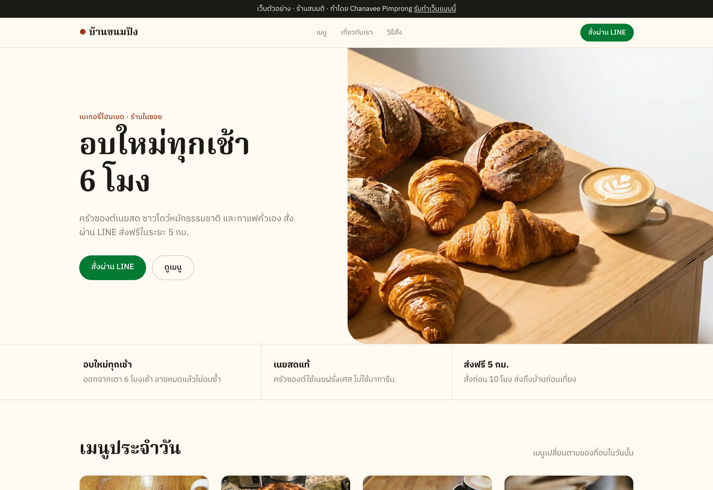
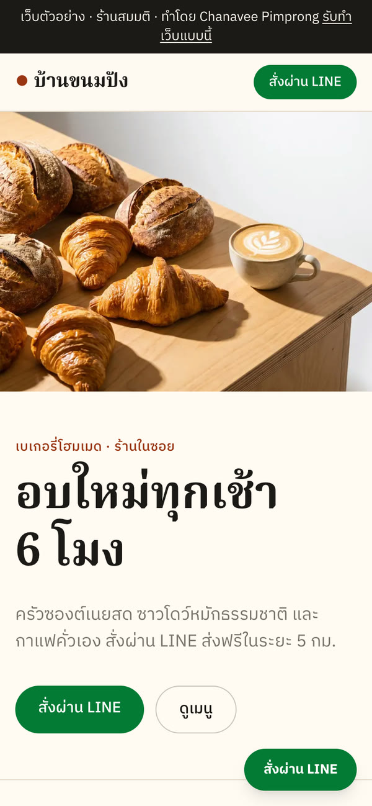

# บ้านขนมปัง · Landing Page ตัวอย่าง

เว็บหน้าเดียวของร้านเบเกอรี่สมมติ ทำเป็นผลงานตัวอย่างของบริการ
[รับทำเว็บไซต์ Landing Page](https://fastwork.co/user/chasvitf/web-development-39307955)
โดย [Chanavee Pimprong](https://chanavee.vercel.app)

**เปิดดูเว็บจริง: https://baankanompang.vercel.app**



## คะแนน Lighthouse

วัดเมื่อ 18 ต.ค. 2026 ด้วย Lighthouse 12.8.2 บน Chrome (มือถือวัด 3 รอบ ใช้การจำลองเครื่องและเน็ตช้าตามค่าเริ่มต้น)

| อุปกรณ์ | Performance | Accessibility | Best Practices | SEO |
|---|---|---|---|---|
| มือถือ | 96–99 (ค่ากลาง 98) | 100 | 100 | 100 |
| คอมพิวเตอร์ | 100 | 100 | 100 | 100 |

วัดเองได้ที่ [PageSpeed Insights](https://pagespeed.web.dev/analysis?url=https%3A%2F%2Fbaankanompang.vercel.app)
(ตัวเลขขยับได้เล็กน้อยตามเครื่องและเครือข่ายที่ใช้วัด)

## ในหน้ามีอะไรบ้าง

- ส่วนหัวพร้อมปุ่ม "สั่งผ่าน LINE" และปุ่มลอยบนมือถือ
- จุดเด่นของร้าน 3 ข้อ
- เมนูพร้อมรูปและราคา และรายการเมนูอื่น ๆ
- เรื่องราวของร้าน
- ขั้นตอนสั่ง เวลาเปิด และเงื่อนไขจัดส่ง
- โหมดมืดอัตโนมัติตามเครื่องผู้ใช้ สีตัวอักษรผ่านเกณฑ์ความคมชัด 4.5:1 ทั้งสองโหมด
- SEO พื้นฐาน: title, description, รูปพรีวิวเวลาแชร์ลิงก์ (Open Graph), `robots.txt`, `sitemap.xml`
- รูปผ่าน `next/image` ย่อขนาดและแปลงเป็น WebP / AVIF ให้เหมาะกับแต่ละหน้าจออัตโนมัติ



## แก้เป็นร้านของคุณ

ข้อมูลร้านทั้งหมดอยู่ใน [`src/site.config.ts`](src/site.config.ts) ไฟล์เดียว:
ชื่อร้าน ข้อความ สีแบรนด์ เมนูและราคา เวลาเปิด และขั้นตอนสั่ง
เปลี่ยนรูปได้โดยวางไฟล์ใน `public/img/` แล้วแก้ชื่อไฟล์ใน config

เว็บนี้เป็นร้านสมมติ ปุ่ม LINE จึงลิงก์ไปหน้าบริการรับทำเว็บแทนบัญชีร้าน
ถ้าใช้กับร้านจริง ให้เปลี่ยนเป็นลิงก์ LINE OA และเบอร์โทรของร้าน แล้วลบแถบ "เว็บตัวอย่าง" ด้านบนออก

## รันบนเครื่อง

```bash
npm install
npm run dev      # http://localhost:3000
npm run build    # ต้องผ่านก่อนขึ้นเว็บจริง
npm run lint
```

ขึ้นเว็บด้วย Vercel: `npx vercel --prod`

## เทคโนโลยี

Next.js 16 · React 19 · TypeScript · Tailwind CSS 4 · Vercel
ฟอนต์ IBM Plex Sans Thai และ Noto Serif Thai (Google Fonts ผ่าน `next/font`)

## เครดิตรูปภาพ

| ไฟล์ | ที่มา |
|---|---|
| `hero.jpg` | สร้างด้วย AI (Gamma) |
| `croissant.jpg` | [Croissant with jam and butter - Little Miss Piggies](https://commons.wikimedia.org/wiki/File:Croissant_with_jam_and_butter_-_Little_Miss_Piggies.jpg) · Wikimedia Commons · CC0 |
| `sourdough.jpg` | [Loaf of sourdough bread cooling](https://commons.wikimedia.org/wiki/File:Loaf_of_sourdough_bread_cooling.jpg) · Wikimedia Commons · CC0 |
| `cinnamon.jpg` | [Cinnamon bun - Black Mocha 2024-01-08](https://commons.wikimedia.org/wiki/File:Cinnamon_bun_-_Black_Mocha_2024-01-08.jpg) · Wikimedia Commons · CC0 |
| `latte.jpg` | [Latte art 3](https://commons.wikimedia.org/wiki/File:Latte_art_3.jpg) · Wikimedia Commons · CC0 |
| `shelves.jpg` | [Bread at a Massachusetts bakery](https://commons.wikimedia.org/wiki/File:Bread_at_a_Massachusetts_bakery.jpg) · Wikimedia Commons · CC0 |

โค้ดใช้สัญญาอนุญาต MIT ([LICENSE](LICENSE))
